<div align="center">

# Projet intégré STM32 – Étape 1

### Détection distribuée de secousses sismiques


</div>

## 1. Objectif
L'objectif de cette première étape est de mettre en place les fondations matérielles et logicielles du système embarqué sur la carte **NUCLEO-F767ZI**.

Cette étape consiste à développer une architecture multitâche basée sur **FreeRTOS**, permettant l'acquisition des données de l'accéléromètre, la supervision du fonctionnement du programme et l'établissement des premières communications réseau.

Une attention particulière sera portée à la **modularité du code**, à la réutilisation des fonctions et à la séparation des différentes responsabilités afin de faciliter l'intégration des fonctionnalités des étapes suivantes. 

---

## 2. Fonctionnalités à implémenter

- [ ] Configuration des périphériques dans STM32CubeIDE.
- [ ] Mise en place de FreeRTOS.
- [ ] Implémentation de la tâche maître.
- [ ] Acquisition des trois axes de l'accéléromètre ADXL335 par DMA.
- [ ] Échantillonnage à une fréquence de 100 Hz.
- [ ] Implémentation d'un heartbeat.
- [ ] Gestion centralisée des messages de debug via UART.*cette tache sera peut etre pas presente, une autre technique de debug est envisagée.
- [ ] Configuration de la communication Ethernet avec LwIP.
- [ ] Envoi d'un message UDP broadcast toutes les 30 secondes.
- [ ] Tests unitaires des différents modules.
- [ ] Intégration et validation globale de l'étape 1.

---

## 2. Description des différentes Task de l'étape 1

### 1. Tâche maître — MasterTask

La tâche maître sera responsable de la gestion et de la supervision générale du système.

**Responsabilités :**

- Détecter l'appui sur le bouton du mode "pause".
- Gérer l'état du système (actif ou arrêté).
- La LED Rouge indiquera si le systeme est en mode de fonctionnement.
- Autoriser le démarrage des différentes tâches.
- Assurer l'arrêt contrôlé des différentes fonctionnalités.
- Synchroniser le fonctionnement des tâches.
- Envoyer des messages de diagnostic à la tâche de Debug.

---

### 2. Tâche d'acquisition — AcquisitionTask

Cette tâche sera responsable de l'acquisition des données provenant de l'accéléromètre ADXL335.

**Responsabilités :**

- Démarrer et arrêter l'acquisition ADC avec DMA.
- Utiliser un timer pour déclencher les conversions à une fréquence de 100 Hz.
- Récupérer les valeurs des axes X, Y et Z.
- Attendre la disponibilité des nouvelles données à l'aide d'un sémaphore ou d'une notification.
- Mettre les données acquises à disposition des autres modules.
- Transmettre des informations de diagnostic à la tâche Debug.

> [!NOTE]
> Aucun traitement RMS ni filtrage des données ne sera effectué durant l'étape 1.

---

### 3. Tâche Heartbeat — HeartbeatTask

Cette tâche permettra de vérifier visuellement que le programme est en cours d'exécution grâce au clignotement périodique d'une LED.

**Responsabilités :**

- Initialiser la gestion de la LED heartbeat.
- Allumer, éteindre et inverser l'état de la LED.
- Générer un clignotement périodique.
- Utiliser les mécanismes de temporisation de FreeRTOS.
- Respecter les instructions de démarrage et d'arrêt de la tâche maître.

La période du heartbeat sera configurable afin de pouvoir être modifiée facilement.

---

### 4. Tâche Debug (DebugTask)

La tâche Debug aurait pour objectif de centraliser les messages
de diagnostic provenant des différentes tâches du système
et de les transmettre via UART.

Cependant, STM32CubeIDE propose des outils de diagnostic
spécifiquement adaptés à FreeRTOS.

Ces outils permettent notamment de :

- Visualiser les différentes tâches et leurs états.
- Vérifier les priorités des tâches.
- Analyser l'utilisation de la mémoire Stack.
- Analyser le temps d'exécution de chaque tâche.
- Observer les sémaphores.
- Observer les files de messages.
- Visualiser les timers FreeRTOS.

Nous étudierons la possibilité d'exploiter ces outils afin
de faciliter le développement et le diagnostic du système.


**Documentation :**

[How to enable FreeRTOS Run Time and Stack Usage view](https://community.st.com/stm32-mcus-60/how-to-enable-freertos-run-time-and-stack-usage-view-126326)

---

### 5. Tâche Broadcast (BroadcastTask)

La tâche Broadcast permettra à chaque carte NUCLEO de signaler périodiquement sa présence sur le réseau Ethernet.

La communication reposera sur le protocole UDP et sur l'utilisation de la bibliothèque LwIP.

**Fonctionnalités à implémenter :**

- Vérification de la disponibilité du réseau.
- Création d'un message de présence au format JSON.
- Identification de la carte NUCLEO.
- Envoi du message vers l'adresse broadcast du réseau.
- Répétition de l'envoi toutes les 30 secondes.
- Gestion des erreurs de transmission.
- Transmission des informations de diagnostic à la tâche Debug, si celle-ci est conservée.
- Démarrage et arrêt des envois sur instruction de la tâche maître.

**Configuration réseau :**

| Paramètre | Valeur |
|---|---|
| Réseau | `192.168.1.0/28` |
| Masque | `255.255.255.240` |
| Adresse IP | `192.168.1.7` |
| Adresse broadcast | `192.168.1.15` |
| Protocole | UDP |
| Port | `12345` |
| Périodicité | 30 secondes |
| Format des messages | JSON |

#### Format du message de présence

Le message envoyé périodiquement devra respecter la structure JSON définie dans l'énoncé du projet.

```json
{
    "type": "presence",
    "id": "nucleo-01",
    "ip": "192.168.1.2",
    "timestamp": "2025-10-02T08:20:00Z"
}
```

**Description des champs :**

| Champ | Type | Description |
|---|---|---|
| `type` | String | Type du message (`presence`) |
| `id` | String | Identifiant unique de la carte NUCLEO |
| `ip` | String | Adresse IP de la carte émettrice |
| `timestamp` | String | Date et heure d'émission du message au format ISO 8601 |

> [!NOTE]
> L'adresse IP `192.168.1.2` est utilisée à titre d'exemple afin de respecter le sous-réseau imposé `192.168.1.0/28`.
> L'identifiant et l'adresse IP devront être propres à chaque carte.
> L'horodatage présenté est un exemple. Sa gestion définitive sera réalisée lors de l'intégration de la RTC et de la synchronisation NTP.


---

## Configuration matérielle et logicielle — STM32CubeMX

### 1. Configuration des horloges (Clock Configuration)

La configuration initiale des horloges a été conservée sans modification.

| Paramètre | Fréquence |
|---|---:|
| HSE | 8 MHz |
| SYSCLK | 96 MHz |
| HCLK | 96 MHz |
| APB1 | 48 MHz |
| APB1 Timer | 96 MHz |
| APB2 | 96 MHz |
| APB2 Timer | 96 MHz |

Ces fréquences serviront de référence pour le calcul des paramètres du timer utilisé pour l'acquisition de l'accéléromètre à 100 Hz.

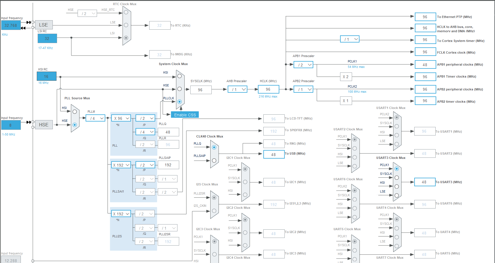

*Figure 1 – Configuration des horloges du STM32F767ZI.*

---

### 2. Configuration des GPIO
Les GPIO sont utilisées pour la gestion des trois LED intégrées à la carte NUCLEO-F767ZI ainsi que du bouton poussoir permettant de démarrer et d'arrêter le système.

#### Affectation des broches

| Broche | Fonction | Configuration |
|---|---|---|
| `PB0` | LED verte (LD1) | GPIO Output |
| `PB7` | LED bleue (LD2) | GPIO Output |
| `PB14` | LED rouge (LD3) | GPIO Output |
| `PC13` | Bouton poussoir (B1) | External Interrupt |

#### Configuration des LED

Les trois LED sont configurées avec les paramètres suivants :

- GPIO Mode : Output Push Pull.
- GPIO Output Level : Low.
- GPIO Pull-up/Pull-down : No pull-up and no pull-down.
- Maximum Output Speed : Low.

Ces LED permettront notamment de visualiser l'état de fonctionnement du système et de générer le heartbeat.

#### Configuration du bouton poussoir

Le bouton poussoir est configuré en interruption externe (EXTI13). Cette configuration permettra de détecter un appui sans devoir interroger continuellement l'état de la broche.

L'événement généré sera utilisé par la tâche maître pour gérer le démarrage et l'arrêt du système.

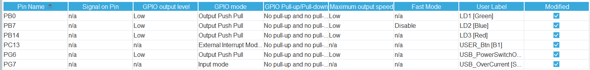

*Figure 2 – Configuration des GPIO dans STM32CubeMX.*

---

### 3. Configuration de l'ADC
L'ADC1 est utilisé pour réaliser l'acquisition des trois sorties analogiques de l'accéléromètre ADXL335.

#### Affectation des broches

| Axe | Broche | Canal ADC | Label |
|---|---|---|---|
| X | PA6 | ADC1_IN6 | ADXL_X |
| Y | PA5 | ADC1_IN5 | ADXL_Y |
| Z | PA4 | ADC1_IN4 | ADXL_Z |

Les trois broches sont configurées en mode analogique, sans résistance Pull-up ou Pull-down interne.

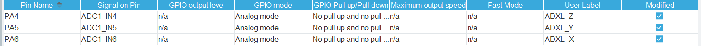

*Figure 3 – Affectation des broches de l'accéléromètre ADXL335.*

#### Paramètres de conversion

| Paramètre | Configuration |
|---|---|
| ADC | ADC1 |
| Mode | Independent Mode |
| Clock Prescaler | PCLK2 divided by 4 |
| Fréquence ADC | 24 MHz |
| Résolution | 12 bits |
| Data Alignment | Right Alignment |
| Scan Conversion Mode | Enabled |
| Continuous Conversion Mode | Disabled |
| Discontinuous Conversion Mode | Disabled |
| DMA Continuous Requests | Enabled |
| End Of Conversion | Single Channel Conversion |
| Number Of Conversion | 3 |
| External Trigger Source | Timer 2 Trigger Out Event |
| External Trigger Edge | Rising Edge |

Le mode Scan Conversion permet de convertir successivement les trois canaux analogiques lors de chaque déclenchement.

Le mode Continuous Conversion est désactivé afin de laisser le timer TIM2 contrôler la fréquence d'acquisition.

Les requêtes DMA continues sont activées afin de permettre le transfert automatique des résultats après chaque conversion.

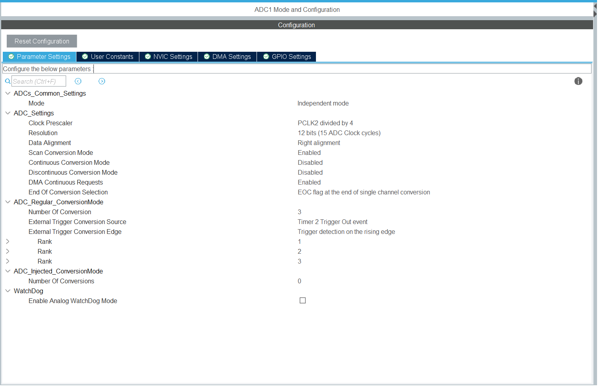

*Figure 4 – Configuration des paramètres de conversion de l'ADC1.*

---

### 4. Configuration du DMA
Le DMA permet de transférer automatiquement les résultats des conversions ADC vers la mémoire sans intervention permanente du processeur.

#### Paramètres du DMA

| Paramètre | Configuration |
|---|---|
| DMA Request | ADC1 |
| Stream | DMA2 Stream 0 |
| Direction | Peripheral To Memory |
| Priority | Low |
| Mode | Circular |
| Peripheral Increment | Disabled |
| Memory Increment | Enabled |
| Peripheral Data Width | Half Word (16 bits) |
| Memory Data Width | Half Word (16 bits) |
| FIFO | Disabled |

Le mode circulaire permet de réutiliser automatiquement le buffer de réception après son remplissage.

L'incrémentation de l'adresse mémoire permet de stocker les résultats des différents canaux dans des emplacements distincts.

L'utilisation du format Half Word permet de stocker les résultats ADC de 12 bits dans des variables de 16 bits.

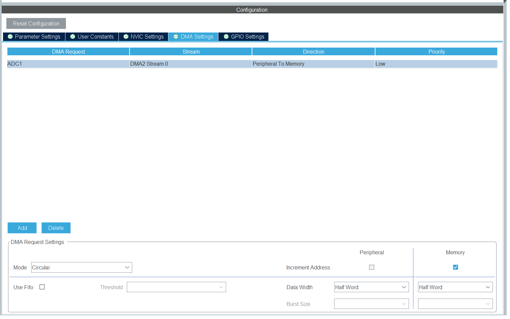

*Figure 5 – Configuration du DMA associé à l'ADC1.*

#### Configuration des interruptions DMA

| Interruption | État | Priorité |
|---|---|---|
| ADC Global Interrupt | Disabled | — |
| DMA2 Stream 0 Global Interrupt | Enabled | 5 |

L'interruption DMA permettra de signaler la disponibilité des nouvelles données à la tâche d'acquisition.

La synchronisation entre l'interruption et la tâche FreeRTOS pourra être réalisée à l'aide d'un sémaphore ou d'une notification.

La compatibilité de la priorité d'interruption avec la configuration FreeRTOS devra être vérifiée.

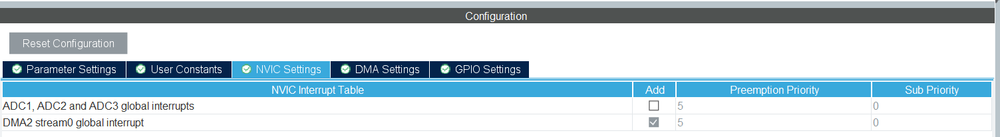

*Figure 6 – Configuration des interruptions DMA dans le NVIC.*

---

### 5. Configuration du Timer et du TRGO
Le timer TIM2 est utilisé pour déclencher automatiquement les conversions ADC à une fréquence de 100 Hz.

#### Paramètres du timer

| Paramètre | Configuration |
|---|---|
| Timer | TIM2 |
| Clock Source | Internal Clock |
| Fréquence d'entrée | 96 MHz |
| Prescaler (PSC) | 95 |
| Counter Period (ARR) | 9999 |
| Counter Mode | Up |
| Clock Division | No Division |
| Auto-Reload Preload | Disabled |
| Master/Slave Mode | Disabled |
| Trigger Output (TRGO) | Update Event |

#### Calcul de la fréquence d'échantillonnage

La fréquence de débordement du timer est déterminée par la formule suivante :

$$
f_{update} = \frac{f_{TIM2}}{(PSC+1)(ARR+1)}
$$

En appliquant les paramètres sélectionnés :

$$
f_{update} = \frac{96\,000\,000}{(95+1)(9999+1)}
$$

$$
f_{update} = 100\ Hz
$$

La période d'échantillonnage est donc :

$$
T = \frac{1}{100} = 10\ ms
$$

Toutes les 10 ms, le timer génère un Update Event transmis à l'ADC par le signal TRGO.

Ce mécanisme permet de garantir une fréquence d'acquisition régulière indépendamment de l'exécution des tâches FreeRTOS.

Aucun canal de capture ou de comparaison du timer n'est nécessaire, puisque seul le signal TRGO est utilisé.

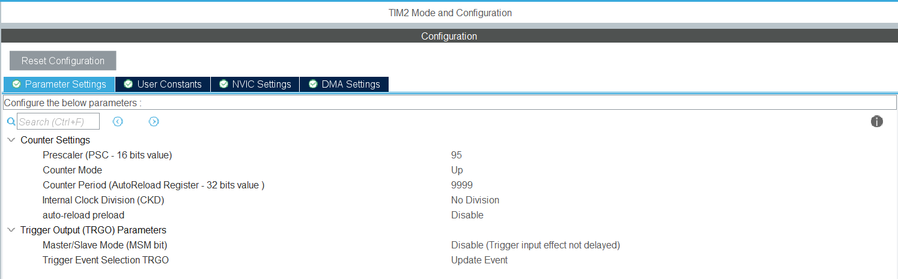

*Figure 7 – Configuration du timer TIM2 et du déclenchement TRGO.*

#### Principe de fonctionnement de l'acquisition

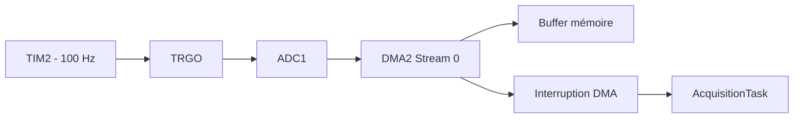

---

### 6. Configuration de l'UART

### 7. Configuration Ethernet

### 8. Configuration de LwIP

### 9. Configuration de FreeRTOS
FreeRTOS est utilisé afin de permettre l'exécution concurrente des différentes fonctionnalités du système.

#### Interface utilisée

L'interface CMSIS-RTOS V2 a été sélectionnée afin de faciliter l'utilisation des fonctionnalités de FreeRTOS.

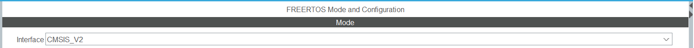

*Figure 8 – Sélection de l'interface CMSIS-RTOS V2.*

#### Configuration des tâches

Les différentes tâches ont été déclarées directement dans le fichier IOC.

| Tâche | Priorité | Stack (Words) | Stack (Octets) |
|---|---|---:|---:|
| defaultTask | Normal | 256 | 1024 |
| masterTask | Above Normal | 256 | 1024 |
| acquisitionTask | High | 256 | 1024 |
| heartbeatTask | Low | 256 | 1024 |
| broadcastTask | Normal | 512 | 2048 |
| debugTask | Below Normal | 256 | 1024 |

Toutes les tâches utilisent actuellement une allocation dynamique de la mémoire.

#### Justification des priorités

- **AcquisitionTask :** priorité haute afin de traiter rapidement les données provenant du DMA.
- **MasterTask :** priorité supérieure à la normale afin de contrôler rapidement les changements d'état du système.
- **BroadcastTask :** priorité normale, la communication réseau ne nécessitant pas un traitement permanent.
- **DebugTask :** priorité inférieure à la normale afin de limiter l'impact des transmissions UART sur les autres tâches.
- **HeartbeatTask :** priorité basse, cette tâche n'étant pas critique pour l'acquisition.
- **DefaultTask :** priorité normale pour les opérations d'initialisation, notamment celles associées à LwIP.

La tâche Broadcast dispose actuellement d'une stack plus importante en raison des opérations de communication réseau et de création des messages JSON.

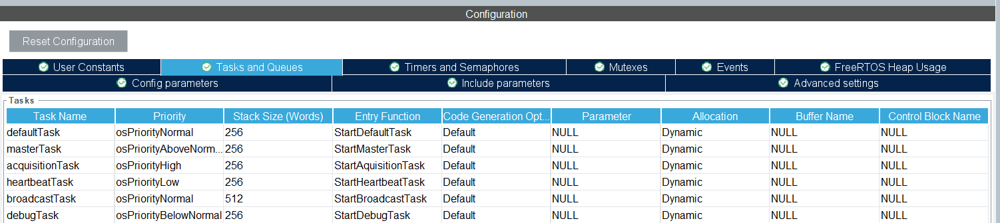

*Figure 9 – Configuration des tâches, des priorités et des stacks FreeRTOS.*

> [!NOTE]
> Les tailles des stacks et les priorités constituent une configuration initiale. Elles pourront être ajustées après analyse du comportement réel du programme.

#### Configuration des fonctions FreeRTOS

Plusieurs fonctions FreeRTOS sont activées dans la section Include Parameters.

| Fonction | Utilisation |
|---|---|
| vTaskPrioritySet | Modification de la priorité d'une tâche |
| uxTaskPriorityGet | Lecture de la priorité d'une tâche |
| vTaskDelete | Suppression d'une tâche |
| vTaskSuspend | Suspension d'une tâche |
| vTaskDelay | Temporisation relative |
| vTaskDelayUntil | Exécution périodique d'une tâche |
| xTaskGetSchedulerState | Consultation de l'état du scheduler |
| xTaskResumeFromISR | Reprise d'une tâche depuis une interruption |
| uxTaskGetStackHighWaterMark | Analyse de l'espace minimal restant dans la stack |
| eTaskGetState | Consultation de l'état d'une tâche |

L'activation de ces fonctions permet leur utilisation lors du développement et du diagnostic du système.

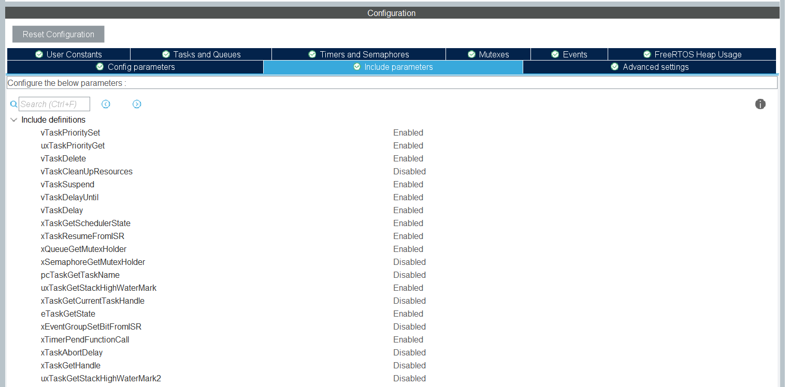

*Figure 10 – Configuration des fonctions disponibles dans FreeRTOS.*

---

#### 9.1. Création des tâches

#### 9.2. Priorités des tâches

#### 9.3. Taille des stacks

#### 9.4. Sémaphores et mécanismes de synchronisation

#### 9.5. Message Queue

### 10. Configuration des outils de debug FreeRTOS

## Fichiers

- [Projet STM32CubeIDE](firmware/ProjetIntegrerFreertos)
- [Configuration CubeMX](firmware/ProjetIntegrerFreertos/ProjetIntegrerFreertos.ioc)
- [Logigramme Draw.io](docs/Logigramme_reseau_sismique.drawio)
